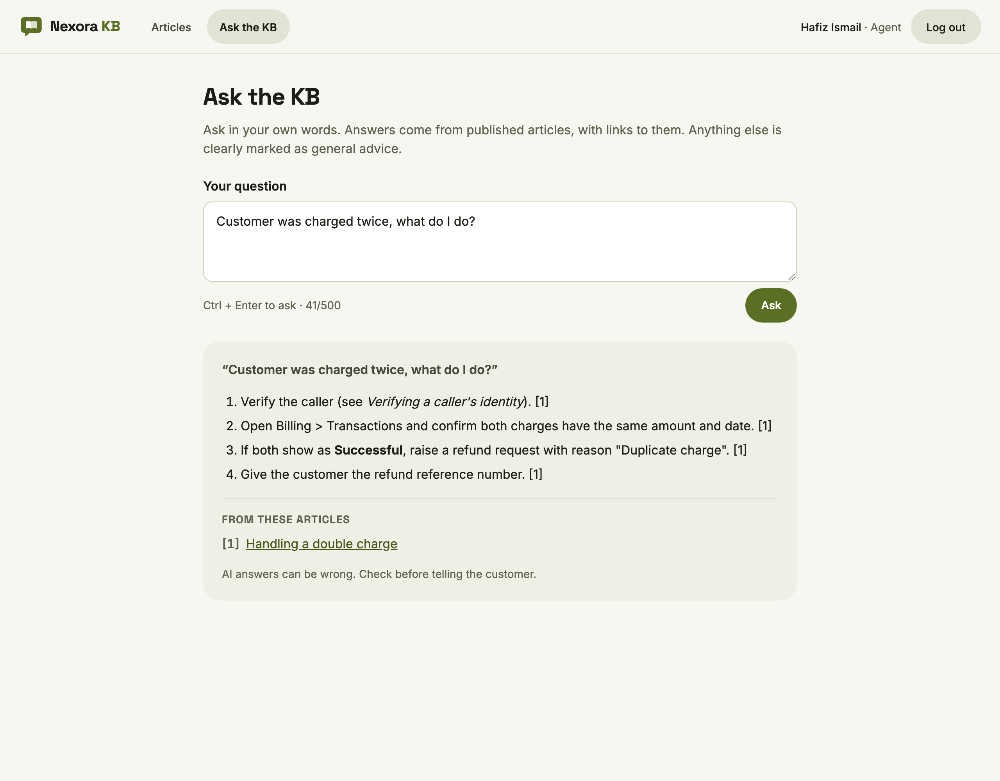
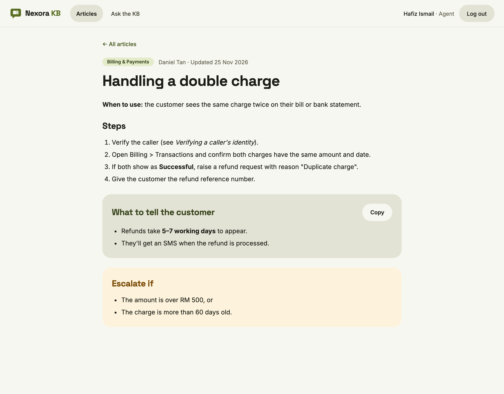
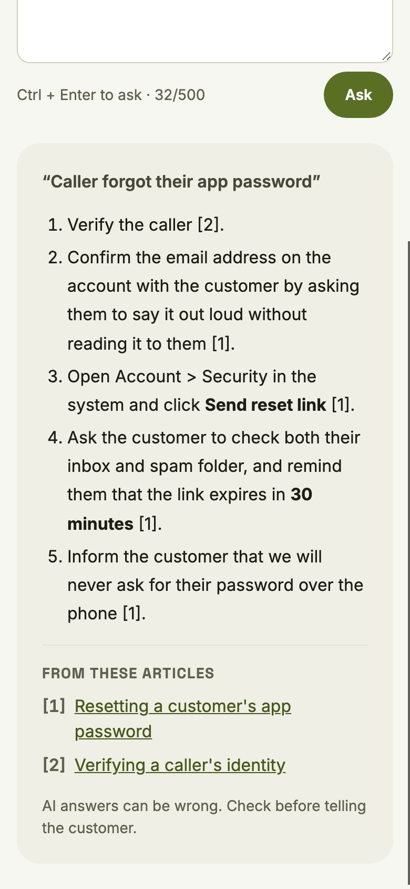
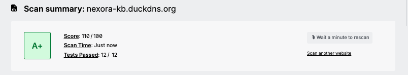
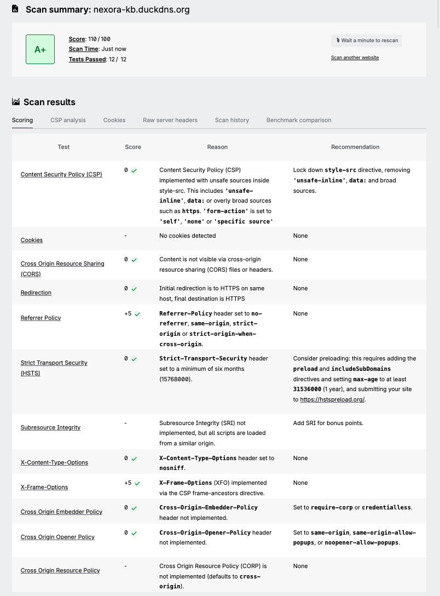

<div align="center">


# Nexora KB

**A knowledge base for contact centre agents, with an AI assistant that answers from your own articles.**

Agents search or just ask a question, and get the steps they need while the customer is still on the line.
Editors write the articles. Admins look after users and categories.


**[Live demo](https://nexora-kb.duckdns.org)** · [Quick start](#quick-start) · [Features](#features) · [Screenshots](#screenshots) · [Highlights](#highlights) · [Deployment](#deployment) · [How it works](docs/how-it-works.md)

<br />



</div>

<br />

## Features

**For agents**
- **Search that forgives you.** Type `ref` and you'll find *Refund and cancellation policy*. Results are ranked, not just matched.
- **Ask the KB.** Ask in plain words ("customer was billed twice") and get short numbered steps, each one linked to the article it came from.
- **Copy for the customer.** Every article has a highlighted *What to tell the customer* box with a one-click Copy button, and an amber *Escalate if* box.
- **Works on a phone**, with a compact menu and no sideways scrolling.

**For editors**
- **Write with a guided form**: one box per section, so every article has the same shape. Markdown works inside the boxes.
- **Preview** exactly what agents will see before saving.
- **Import from PDF.** Drop in an existing procedure, even a scanned one, and the form fills itself in for you to check.
- **Drafts** stay hidden from agents (and from the AI) until you publish.

**For admins**
- **Users**: add people, change roles and emails, deactivate and reactivate. The system admin account is protected.
- **Categories**: add, rename and delete, with article counts. A category that still has articles can't be deleted.

## Screenshots

| Browse and search | Read an article |
| :---: | :---: |
|  |  |
| **Ask the KB, with general advice when no article covers it** | **Import a PDF into the article form** |
|  |  |
| **Manage users** | **Manage categories** |
|  |  |

<details>
<summary><b>On a phone</b></summary>
<br />
<p align="center">
  
  &nbsp;&nbsp;
  
</p>
</details>

## Quick start

**You'll need** Node.js 22+ and Docker.

```bash
# 1. start MySQL (runs on port 3307 so it won't clash with a local MySQL)
docker compose up -d

# 2. backend
cd backend
cp .env.example .env              # then set JWT_ACCESS_SECRET, e.g. openssl rand -hex 32
npm install
npx prisma migrate deploy         # creates the tables and the search index
npm run db:seed                   # demo users, categories and 20 articles
npm run dev                       # API on http://localhost:3000/api

# 3. frontend (in a second terminal)
cd frontend
npm install
npm start                         # app on http://localhost:4200
```

Open **http://localhost:4200** and sign in with one of the demo accounts below.

> [!TIP]
> **The AI features are optional.** Without a key, everything works except *Ask the KB* and *Import from PDF*, which politely say "AI unavailable".
> To turn them on, put a free key from [Google AI Studio](https://aistudio.google.com/) in `backend/.env` as `GEMINI_API_KEY`, restart the API, and run `npm run db:embed` once so the existing articles can be searched by meaning.

### Or run the whole app in Docker

```bash
cp .env.example .env              # fill in the two passwords and JWT_ACCESS_SECRET
docker compose -f docker-compose.prod.yml up -d --build
docker compose -f docker-compose.prod.yml run --rm migrate npm run db:seed
```

Then open **http://localhost**. This is the same setup that runs the live demo.

### Demo accounts

Every account uses the password **`Password123!`**

| Who | Email | Role | Try this |
| --- | --- | --- | --- |
| Admin User | `admin@nexora.test` | Admin | Users and Categories pages. This account is the protected system admin. |
| Daniel Tan | `editor@nexora.test` | Editor | Write an article, import a PDF, see *My articles* |
| Priya Nair | `editor2@nexora.test` | Editor | Owns other articles, so you can see that editors only edit their own |
| Hafiz Ismail | `agent@nexora.test` | Agent | Search, read, copy, and Ask the KB |
| Mei Ling Wong | `agent2@nexora.test` | Agent | Deactivated, so login is refused |

The demo company, **Nexora Telecom**, is made up. So are all the names, prices and policies.

## Tech stack

| Layer | What | Why |
| --- | --- | --- |
| Frontend | **Angular 22**, signals, reactive forms, plain **SCSS** | No UI library, as the brief asked for a simple CSS UI. Colours and spacing live in one tokens file. |
| Backend | **Node.js + Express 5**, **TypeScript** | Small, explicit layers: route → middleware → controller → service → repository |
| Database | **MySQL 8.4** (LTS) with **Prisma 7** | Prisma for migrations and everyday queries, raw SQL where it matters (search, reports) |
| Validation | **zod** | One schema checks a request and gives the TypeScript type |
| Auth | **JWT** access token + **httpOnly** refresh cookie, **argon2** password hashing | Short-lived tokens that can't be read by page scripts |
| AI | **Google Gemini** for answers, embeddings and PDF reading | Free tier, with a fallback across several models |

### How the brief is covered

| The brief asked for | Where to look |
| --- | --- |
| Angular / Node.js / MySQL | `frontend/`, `backend/`, `docker-compose.yml` |
| Authentication | Login, refresh with rotation, logout, rate-limited login, deactivated accounts refused |
| Authorization | Three roles checked on every API route, plus "editors edit only their own articles" |
| CRUD with pages | Articles, categories and users, each with its own pages |
| Simple CSS-based UI | Hand-written SCSS, no component library |

## Highlights

- **Safe sessions.** A 15-minute access token kept in memory, and a refresh token in an httpOnly cookie that's replaced on every use and stored only as a hash.
- **Permissions checked by the API**, not just hidden buttons. Editors can only change their own articles, and the system admin can't be locked out.
- **Search that ranks well.** MySQL FULLTEXT with word stemming and prefix matching, so `charged` finds *charge* and `ref` finds *refund*.
- **Ask the KB you can trust.** Keyword and meaning search merged, answers cited to their articles, general advice clearly labelled, and drafts never sent to the AI.
- **Keeps working when the AI doesn't.** Several Gemini models are tried in turn with a 5-second limit, and without a key the rest of the app runs normally.
- **PDF import with a human in the loop.** Gemini fills the form from any procedure PDF, even a scanned one, and nothing is saved until an editor checks it.

**Want the details?** [How it all works](docs/how-it-works.md) covers login, permissions, search, Ask the KB, PDF import, the full API and the design decisions.

## Testing

```bash
cd backend && npm test            # 71 tests: unit + API integration tests against MySQL (Vitest + Supertest)
cd frontend && npm test           # 117 unit tests (Vitest)
```

The backend integration tests send real requests through the real middleware to a separate `kb_test` database, so your demo data is never touched. Gemini is faked in tests, so they're free and give the same result every run. They cover login and token rotation, every permission rule, drafts staying hidden, the 409 rules, the protected admin, search ranking, and how Ask the KB and PDF import handle each kind of AI reply.

Every feature was also checked in a real browser as each role, on desktop and phone.

## Deployment

The live demo runs at **https://nexora-kb.duckdns.org**.

- **Server:** a DigitalOcean Droplet (a small Ubuntu VPS).
- **Containers:** Docker Compose runs MySQL, a one-off migration container, the Express API, and Caddy.
- **Web server:** Caddy serves the Angular build, forwards `/api` to the API, and gets the HTTPS certificate automatically.
- **Domain:** a free DuckDNS subdomain pointing at the Droplet.
- **Security headers:** HSTS, a strict Content-Security-Policy, frame protection and the other standard headers. The site scores **A+ (110/100)** on [Mozilla's HTTP Observatory](https://developer.mozilla.org/en-US/observatory/analyze?host=nexora-kb.duckdns.org).

<p align="center">
  
</p>

<details>
<summary><b>Full scan results</b></summary>
<br />

</details>

The app and the API share one address, so the login cookie stays first-party. Updating it is `git pull` and `docker compose -f docker-compose.prod.yml up -d --build`; migrations run on their own.

Having trouble running it? See [Troubleshooting](docs/how-it-works.md#troubleshooting).
