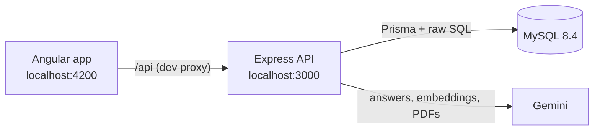
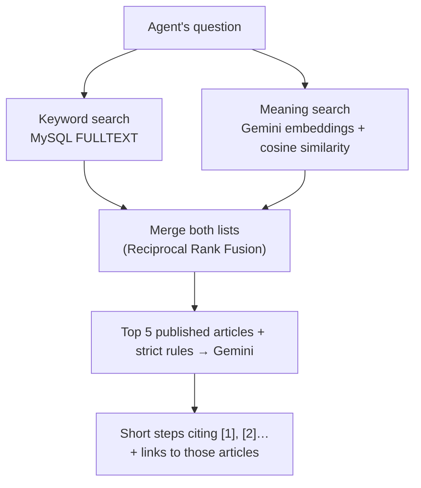

# How Nexora KB works

The detail behind the [README](../README.md): how login, permissions, search, Ask the KB and PDF import work, the full API, and why things were built this way.

**On this page:** [How it works](#how-it-works) · [API](#api) · [Testing](#testing) · [Project structure](#project-structure) · [Design decisions](#design-decisions) · [Troubleshooting](#troubleshooting)

## How it works



### Logging in

The password is checked with **argon2**. On success the API returns a **15-minute access token**, which the app keeps **in memory only** (never in localStorage), and sets a **7-day refresh token** in an **httpOnly cookie** that page scripts can't read.

- When the access token runs out, the next request gets a 401. The app quietly refreshes and retries, so you never notice.
- Reloading the page restores your session from the cookie before anything else loads.
- Every refresh **replaces** the refresh token (rotation). Only a **hash** of it is stored, so a leaked database can't be used to log in.
- A wrong email and a wrong password get the same message, so nobody can find out which emails exist.

### Who can do what

| | Agent | Editor | Admin |
| --- | :---: | :---: | :---: |
| Search, read and copy published articles | Yes | Yes | Yes |
| Ask the KB | Yes | Yes | Yes |
| Write articles, import PDFs, see *My articles* | | Yes | Yes |
| Edit or delete an article | | own only | any |
| Manage categories and users | | | Yes |

The rules are enforced by the **API**. The app only hides buttons you can't use, so calling the API directly (Postman, curl) doesn't get around them.

### Search

The search box turns what you type into a MySQL **FULLTEXT** query:

1. Strip special characters and drop words shorter than 3 letters.
2. Cut common endings, so `charged` becomes `charg`.
3. Add `*` so every form of the word matches: `charg*` finds *charge*, *charged*, *charging*.
4. Rank articles that contain **all** your words first, then exact-word matches, then the rest.

The query runs as **raw SQL** with every value passed as a parameter, so there's no SQL injection.

### Ask the KB

Ask the KB is **retrieval-augmented generation (RAG)**: our code finds the right articles, and Gemini only writes the answer from them.



- **Two searches, one list.** Keywords are best for exact terms like *eSIM*. Meaning search finds "billed twice" even when the article says "double charge". Articles that both searches pick rise to the top.
- **Published only.** Drafts never reach the AI.
- **Honest answers.** Steps from an article are cited. Anything not from an article goes in a clearly labelled *General advice* box (with no prices or deadlines allowed), and off-topic questions are refused.
- **It keeps working.** If one Gemini model is busy or out of quota, the next one is tried, with a 5-second limit each. A model that just failed is skipped for a minute, so only one question pays the wait.

### PDF import

Regex parsing only works when every document follows the same template, and real procedures don't. So Gemini reads the PDF itself (scanned pages too) and returns JSON matching the article form: title, when to use, steps, what to tell the customer, when to escalate.

It **only fills the form.** Nothing is saved until an editor checks it, picks a category and saves it as a draft. Uploads are PDF-only, up to 5 MB, kept in memory, and checked for real PDF bytes.

### Articles and Markdown

Articles are stored as **Markdown** in one column, so search and permissions stay in the database. The form builds the Markdown with fixed headings, which is how the page knows which section goes in the highlighted *What to tell the customer* box. When showing an article, `marked` converts it to HTML and **DOMPurify** strips anything that could run a script.

## API

All routes start with `/api`. Everything except login, refresh, logout and health needs a Bearer token.

| Method | Path | Who | What it does |
| --- | --- | --- | --- |
| `GET` | `/health` | anyone | API and database status |
| `POST` | `/auth/login` | anyone | Log in (20 tries per 15 minutes) |
| `POST` | `/auth/refresh` | cookie | New access token, rotates the refresh token |
| `POST` | `/auth/logout` | cookie | Ends this session |
| `GET` | `/auth/me` | signed in | The current user |
| `GET` | `/articles` | signed in | Published articles: `?q=`, `?categoryId=`, `?page=` |
| `GET` | `/articles/mine` | editor, admin | Your own articles, drafts included |
| `GET` | `/articles/:id` | signed in | One article (someone else's draft is a 404) |
| `POST` | `/articles` | editor, admin | Create |
| `POST` | `/articles/import` | editor, admin | Turn a PDF into article fields (5 per minute) |
| `PUT` | `/articles/:id` | author or admin | Update |
| `DELETE` | `/articles/:id` | author or admin | Delete |
| `GET` | `/categories` | signed in | Categories with published counts |
| `POST` `PUT` `DELETE` | `/categories/:id?` | admin | Manage categories (409 if still in use) |
| `GET` | `/stats/categories` | admin | Published and draft counts per category |
| `GET` `POST` | `/users` | admin | List and create users |
| `GET` `PUT` | `/users/:id` | admin | View and update a user |
| `DELETE` | `/users/:id` | admin | Deactivate (users are never hard-deleted) |
| `POST` | `/ask` | signed in | Ask the KB (10 per minute) |

A **Postman collection** with 77 requests, including the error cases (400, 401, 403, 404, 409), is in [`backend/postman/`](../backend/postman/agent-kb.postman_collection.json). Run a folder's login request first; it saves the token for the rest.

## Testing

```bash
cd frontend && npm test           # 113 unit tests (Vitest)
cd backend && npm run typecheck   # strict TypeScript across the API
```

On top of the unit tests, every feature was checked end to end in a real browser as each role, on desktop and phone width, plus a run with no AI key to make sure everything else still works.

## Project structure

```
agent-knowledge-base/
├── backend/
│   ├── prisma/              schema, migrations, seed data
│   ├── postman/             API collection
│   └── src/
│       ├── routes/          URLs, and which checks run on each
│       ├── middleware/      auth, roles, validation, rate limits, uploads, errors
│       ├── controllers/     read the request, send the response
│       ├── services/        the rules: permissions, search, Ask the KB, PDF import
│       ├── repositories/    every database query lives here
│       ├── lib/             Prisma and Gemini clients
│       └── utils/           tokens, cookies, snippets, ranking
├── frontend/src/app/
│   ├── core/                API services, auth, guards, models
│   ├── layouts/             sign-in layout and the main app layout
│   ├── pages/               articles, article, form, ask, my articles, admin
│   └── shared/              Markdown, article body, data table, pagination, dialogs
├── docs/screenshots/
└── docker-compose.yml       MySQL for local development
```

## Design decisions

A few choices worth explaining:

- **Prisma, plus raw SQL where it counts.** Prisma handles migrations and simple queries. Search and the category report are hand-written SQL (`MATCH … AGAINST`, `LEFT JOIN … GROUP BY`), still fully parameterised.
- **FULLTEXT instead of `LIKE '%word%'`.** It uses an index instead of scanning every row, and it ranks results, which matters when an agent needs the right article at the top.
- **Embeddings stored as JSON.** MySQL 8.4 (the LTS release) has no vector type, and with a few dozen articles, comparing vectors in Node takes under a millisecond. At thousands of articles I'd move to a vector index.
- **One question, one answer, no chat memory.** Agents on a live call need one fast, cited answer. Gemini is stateless, so adding memory would just mean sending earlier turns along. It's easy to add if agents ask for follow-ups.
- **The AI never publishes anything.** PDF import fills the form; a person checks it and saves a draft.
- **Users are deactivated, not deleted.** Their articles keep an author, the action can be undone, and the database would refuse the delete anyway.
- **One form box per heading.** Every article gets the same sections, which is what makes the highlighted boxes and Ask the KB reliable.
- **Pages load on demand.** Each page downloads when it's first opened, so agents never download the admin screens.

## Troubleshooting

- **Port 3307 is in use.** Change the left side of `"3307:3306"` in `docker-compose.yml` and the port in `DATABASE_URL`.
- **"Property … does not exist" in VS Code after changing the schema.** Run `npx prisma generate`, then *TypeScript: Restart TS Server*. `npm run typecheck` is the source of truth.
- **Ask the KB says the AI isn't responding.** Free Gemini models have daily limits. The API tries the models in `GEMINI_MODELS` in order, so add another one or try again later.
- **Logged out after reseeding.** Seeding clears all sessions. Just sign in again.
